<picture>
  <source media="(prefers-color-scheme: dark)" srcset="assets/hero-dark.svg">
  <source media="(prefers-color-scheme: light)" srcset="assets/hero-light.svg">
  
</picture>

 

Shipping products end to end\. Now building Saathi and JARVIS\.

## Reference specimens

| Repository | Role | Purpose |
| --- | --- | --- |
| [`Versio`](https://github.com/krishnadityasingh18-create/Versio)  | WEB APP | Version history and review-first collaboration, no Git\. |
| [`routine-guard`](https://github.com/krishnadityasingh18-create/routine-guard)  | PYTHON LIBRARY | Flags late starts, silences and odd-hour activity\. |

## Classification plate

<picture>
  <source media="(prefers-color-scheme: dark)" srcset="assets/closed-loop-dark.svg">
  <source media="(prefers-color-scheme: light)" srcset="assets/closed-loop-light.svg">
  
</picture>

## Specimen catalog

<strong>Products</strong> · 1 modules

| Module | Purpose |
| --- | --- |
| [`Versio`](https://github.com/krishnadityasingh18-create/Versio) | Version control for creative work, no Git vocabulary\. |

<strong>Detection</strong> · 1 modules

| Module | Purpose |
| --- | --- |
| [`routine-guard`](https://github.com/krishnadityasingh18-create/routine-guard) | Rhythm learning and anomaly rules for timestamped events\. |

<a href="https://github.com/krishnadityasingh18-create">GitHub</a>

<!-- Generated by profile-control-plane. Edit profile.yaml, not this file. -->
